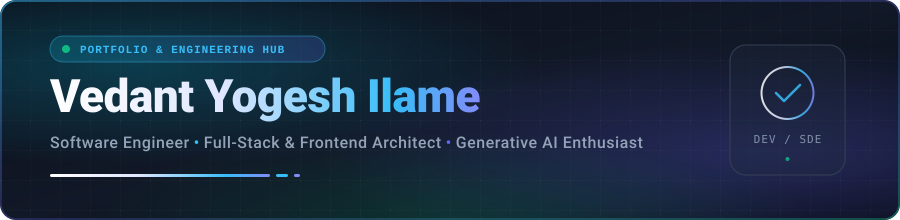

  <!-- Native SVG Header Banner (Zero-Latency, Crisp Vector, 100% Reliable) -->
  

    

  <!-- Dynamic Typing Animation -->
  

  

    <strong>Computer Science Engineer • Full-Stack Developer • Generative AI & UI/UX Enthusiast</strong>
  

  <!-- Connect & Social Badges -->
  

    
    
    
    
  

  <!-- Metric Badges Row -->
  

    
    
    
    
  

---

## 👨‍💻 Executive Summary

> *"Engineering scalable digital systems where clean architecture meets intuitive user experience."*

I am a **Computer Science Graduate (B.Tech '26)** with comprehensive experience across **Full-Stack Web Development (MERN, Next.js)**, **Generative AI**, and **Modern Frontend Engineering**, honed through four specialized internships and end-to-end production projects.

- 🔭 **Core Competencies**: Architecture and deployment of production-grade web applications using React.js, Redux Toolkit, Node.js, Express.js, TypeScript, and MongoDB.
- 🤖 **AI & Intelligence**: Exploring the frontier of Generative AI, LLMs, prompt engineering, and automated NLP sentiment/authenticity pipelines.
- 📱 **Mobile & Distributed Systems**: Hands-on Android native application development and certified foundation in Cloud Computing infrastructure.
- 🎨 **Creative Leadership**: Former **Publicity Committee Head** (Schologamma Forum) & **Creative Committee Head** (Ajeet Forum), combining technical excellence with creative direction and team management.
- 🎯 **Career Focus**: Actively seeking **Software Development Engineer (SDE)** and **Full-Stack Developer** opportunities to build high-impact, performant software.

---

## 💼 Professional Experience & Internships

<table>
  <thead>
    <tr>
      <th width="32%">Organization</th>
      <th width="24%">Role & Duration</th>
      <th width="44%">Key Achievements & Core Technologies</th>
    </tr>
  </thead>
  <tbody>
    <tr>
      <td>
        <b>🚀 Graphura India Private Limited</b> 
        Nagpur, Maharashtra (Remote)
      </td>
      <td>
        <b>Frontend Developer Intern</b> 
        <code>Dec 2025 – Mar 2026</code>
      </td>
      <td>
        • Architected and shipped modular, accessible frontend components using <b>React.js</b>, <b>Tailwind CSS</b>, and <b>REST APIs</b>. 
        • Enhanced page speed, responsiveness, and state handling across core customer-facing platforms. 
        • Collaborated closely with cross-functional design and backend teams to ensure pixel-perfect fidelity.
      </td>
    </tr>
    <tr>
      <td>
        <b>💻 Prodigy InfoTech</b> 
        Nagpur, Maharashtra (Remote)
      </td>
      <td>
        <b>Web Developer Intern</b> 
        <code>Jun 2025 – Dec 2025</code>
      </td>
      <td>
        • Developed full-featured, responsive web interfaces focusing on intuitive navigation and user experience. 
        • Implemented dynamic client-side interactivity, DOM optimizations, and cross-browser validation. 
        • Delivered clean, production-ready code aligned with modern web standards and agile practices.
      </td>
    </tr>
    <tr>
      <td>
        <b>📱 EduSkills Foundation® & AICTE</b> 
        Virtual Internship Program
      </td>
      <td>
        <b>Android Developer Intern</b> 
        <code>Oct 2024 – Dec 2024</code>
      </td>
      <td>
        • Built native Android applications covering core lifecycle management, modern UI patterns, and Android SDK tooling. 
        • Gained practical exposure to mobile architecture patterns and efficient asset management.
      </td>
    </tr>
    <tr>
      <td>
        <b>🤖 EduSkills Foundation® & AICTE</b> 
        Virtual Internship Program
      </td>
      <td>
        <b>AI / ML Intern</b> 
        <code>Apr 2024 – Jun 2024</code>
      </td>
      <td>
        • Developed practical machine learning workflows utilizing <b>Python</b>, data preprocessing, and model evaluation. 
        • Trained, tuned, and evaluated supervised predictive models with industry-standard benchmarks.
      </td>
    </tr>
  </tbody>
</table>

---

## 🛠️ Technical Arsenal & Skill Matrix

### Languages & Frameworks

 

### Developer Tools & Design Suite

 

<b>🔍 Click to view structured domain-wise breakdown</b>

 

| Technical Domain | Competencies & Technologies |
| :--- | :--- |
| **Languages** | `TypeScript` `JavaScript (ES6+)` `Python` `Java` `C#` `SQL` `HTML5` `CSS3` |
| **Frontend Engineering** | `React.js` `Next.js` `AngularJS` `Redux / Redux Toolkit` `Tailwind CSS` `Bootstrap` `Responsive UI/UX` |
| **Backend & APIs** | `Node.js` `Express.js` `RESTful APIs` `Brevo (Sendinblue)` `JWT Auth` `Middleware Architecture` |
| **Databases** | `MongoDB` `MySQL` `Mongoose` `Query Optimization` `Schema Design` |
| **AI, GenAI & ML** | `Generative AI (GenAI)` `Large Language Models (LLMs)` `Prompt Engineering` `OpenAI API` `LangChain (Basics)` `NLP` `Sentiment Analysis` `TensorFlow (Basics)` |
| **Mobile Development** | `Android SDK` `Java / Kotlin` `Mobile UI Architecture` `Lifecycle Management` |
| **Cloud & DevOps** | `Git` `GitHub` `VS Code` `Postman` `Vercel` `Render` `CI/CD Pipelines` `NPTEL Cloud Computing` |
| **Design & Leadership** | `Figma` `UI/UX Wireframing` `Creative Direction` `Videography` `Calligraphy` |

---

## 🌟 Featured Engineering Projects

<table>
  <tr>
    <td width="50%" valign="top">
      <h3 align="center">🛒 Fruits Bounty</h3>
      
<b>Production-Grade MERN E-Commerce Platform</b>

      

        
        
        
        
        
      

      <ul>
        <li>Architected an end-to-end MERN e-commerce marketplace featuring custom dynamic fruit-bowl assembly logic.</li>
        <li>Integrated secure <b>Razorpay payment gateway</b>, inventory management, and real-time Admin order tracking.</li>
        <li>Achieved 100% mobile responsiveness and <b>sub-2s page load speeds</b> via query indexing and lazy loading.</li>
        <li>Automated CI/CD pipelines deployed across <b>Vercel</b> (Frontend) and <b>Render</b> (Backend).</li>
      </ul>
      

        <a href="https://github.com/vedantilame22/fruitbountyshop"><b>View Code Repository ➔</b></a>
      

    </td>
    <td width="50%" valign="top">
      <h3 align="center">🌐 Global News Network</h3>
      
<b>AI-Verified News Aggregator & Sentiment Engine</b>

      

        
        
        
        
      

      <ul>
        <li>Aggregates live headlines in real time across multiple news categories via media APIs.</li>
        <li>Trained an NLP verification classifier to evaluate authenticity and flag potential misinformation.</li>
        <li>Built an automated <b>sentiment analysis engine</b> to gauge tone, bias, and perspective across articles.</li>
        <li>Modern, responsive interface engineered for high readability on both desktop and mobile.</li>
      </ul>
      

        <a href="https://github.com/vedantilame22"><b>Explore AI Aggregator ➔</b></a>
      

    </td>
  </tr>
  <tr>
    <td width="50%" valign="top">
      <h3 align="center">📋 Task Management System</h3>
      
<b>Scalable Full-Stack Workflow & Productivity App</b>

      

        
        
        
        
      

      <ul>
        <li>Engineered a robust task manager with complete CRUD functionality, dynamic filtering, and status visualizers.</li>
        <li>Implemented centralized <b>Redux Toolkit state management</b>, eliminating redundant re-renders by <b>40%</b>.</li>
        <li>Constructed modular Express REST APIs with JWT authentication and robust error-handling middleware.</li>
      </ul>
      

        <a href="https://github.com/vedantilame22"><b>View System Repo ➔</b></a>
      

    </td>
    <td width="50%" valign="top">
      <h3 align="center">✨ Personal Developer Portfolio</h3>
      
<b>Modern Interactive Showcase & Creative Hub</b>

      

        
        
        
      

      <ul>
        <li>Comprehensive developer portfolio showcasing engineering projects, verified credentials, and internships.</li>
        <li>Engineered reusable component architecture, smooth navigation, and optimized assets for fast load times.</li>
        <li>High SEO scores, responsive breakpoints, and modern aesthetic typography.</li>
      </ul>
      

        <a href="https://github.com/vedantilame22"><b>Explore Live Portfolio ➔</b></a>
      

    </td>
  </tr>
</table>

---

## 📜 Verified Credentials & Education

<b>🎓 Click to inspect certifications and academic background</b>

 

- 🧠 **Microsoft Certified**: Introduction to AI Concepts *(Jul 2026)*
- ☁️ **NPTEL**: Cloud Computing — Distributed Systems, Virtualization & Cloud Economics *(Jul 2025 – Oct 2025)*
- 🌐 **NPTEL**: Social Networks — Mathematical Graph Modeling, Information Flow & Social Algorithms *(Jan 2025 – Apr 2025)*
- 🤖 **AICTE & EduSkills**: AI/ML Virtual Internship *(Apr 2024 – Jun 2024)*
- 📱 **AICTE & EduSkills**: Android Developer Virtual Internship *(Oct 2024 – Dec 2024)*
- 🎓 **B.Tech, Computer Science**: JD College of Engineering & Management, Nagpur (2022 – 2026) | **CGPA: 8.16 / 10**
- 🏫 **HSC (XII), Maharashtra State Board**: Jawaharlal Darda Junior College, Yavatmal — **85.33%** (2022)
- 🏫 **CBSE (X)**: Podar International School, Yavatmal — **88.88%** (2020)

---

## 👥 Leadership & Extracurricular Impact

- 📢 **Publicity Committee Head — Schologamma Forum, JDCOEM (2024 – 2025)**  
  Spearheaded student outreach, public relations campaigns, and technical event promotion, driving substantial engagement across department initiatives.
- 🎨 **Creative Committee Head — Ajeet Forum, JDCOEM (2022 – 2023)**  
  Directed visual branding, multimedia creative design, and stage presentations for annual flagship college symposiums.
- 🤝 **Member — Rotaract Club JDCOEM (2024 – 2025)**  
  Participated in community welfare drives, student mentorship, and collaborative social impact programs.

---

## 📊 GitHub Analytics & Activity

  <table border="0">
    <tr>
      <td align="center" width="50%">
        
      </td>
      <td align="center" width="50%">
        
      </td>
    </tr>
  </table>

   

  

    

  

---

## 💬 Let's Connect

Open to full-time Software Development Engineer (SDE) roles, full-stack opportunities, or collaborative web/AI projects.

  
  &nbsp;
  
  &nbsp;
  

    

  <!-- Footer Banner -->
  

